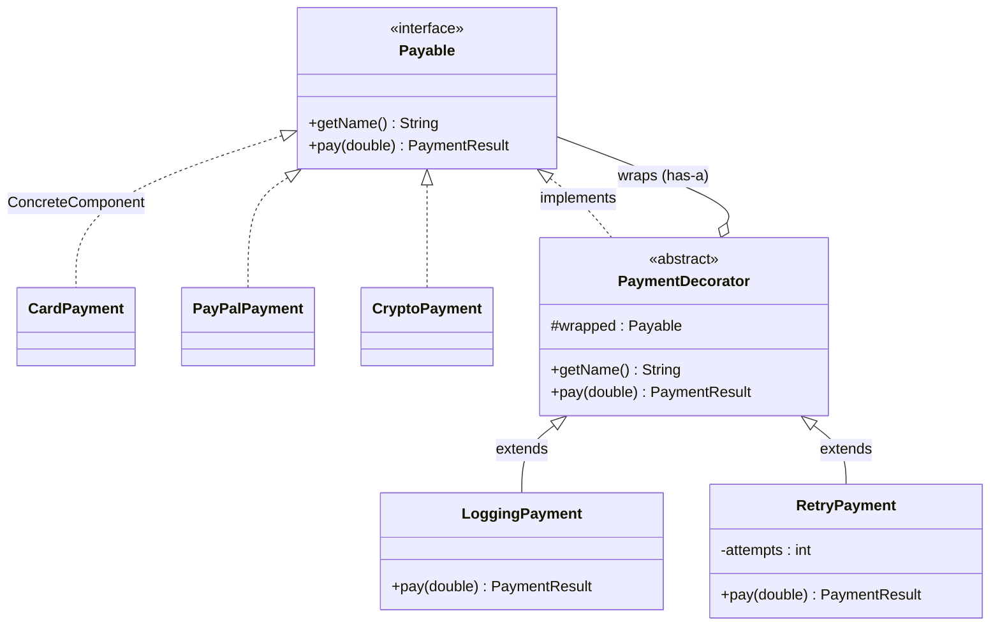
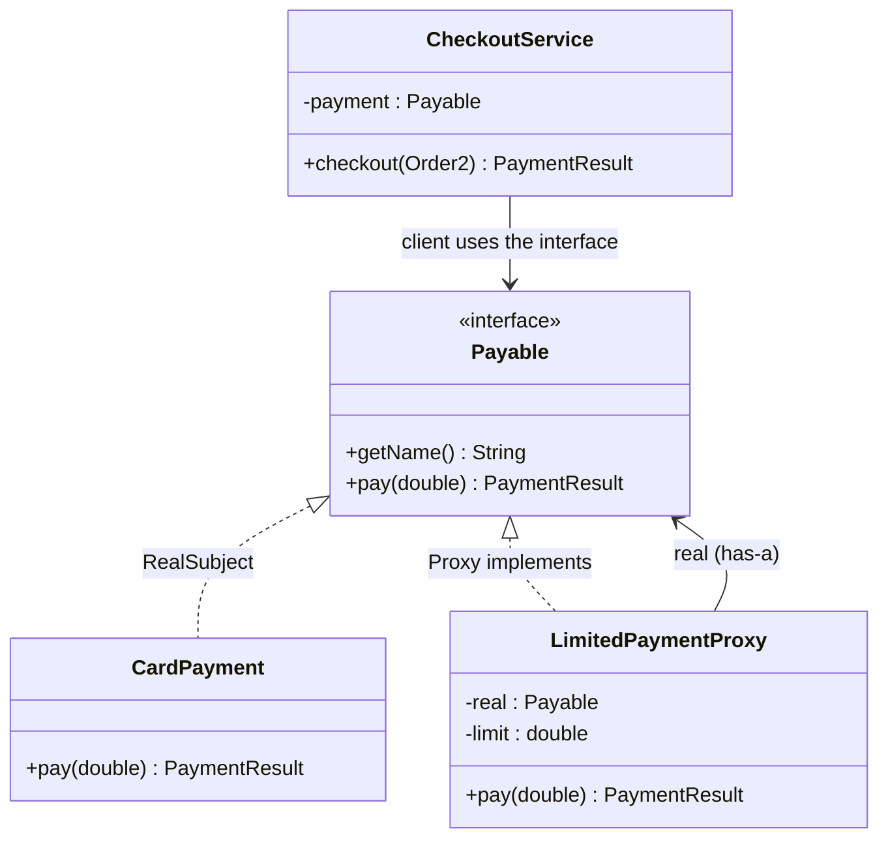
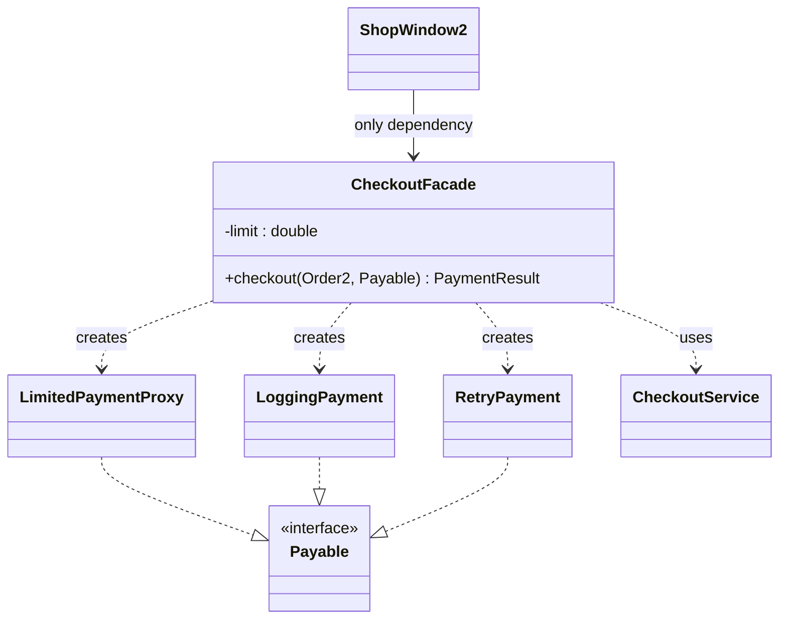

# Topic: *Structural Design Patterns*
Author: Saban Olga
------
## Objectives:
__1. Get familiar with the structural design patterns.__

__2. Reuse the domain of Lab 1 (Online Shop).__

__3. Implement at least 3 structural design patterns that work together and depend on abstractions.__

## Domain: Online Shop
The domain is the online shop from Lab 1, with a desktop (Swing) window. The customer picks products from a catalog, adds them to a cart, chooses a payment method (Card, PayPal or Crypto), pays, receives a receipt and can ask for a refund when the payment method supports it. In this lab the payment step was extended with structural patterns. The Lab 1 code (Singleton, Factory Method, Prototype) is reused and not changed, except that the classes were put into packages and `ShopWindow2.pay()` now calls the facade. The Lab 1 report is in [docs/REPORT_LAB1.md](docs/REPORT_LAB1.md).

Main classes (package `shop.*`):

| Class | Responsibility |
|---|---|
| `app.Main`, `app.ConsoleDemo` | entry points: Swing window / console demo |
| `ui.ShopWindow2` | the main window (Swing GUI); calls the facade when the customer pays |
| `catalog.ItemList2` | the catalog of products, loaded from `items2.csv` (Lab 1, Singleton) |
| `model.Item`, `model.Cart2`, `model.Order2` | product (with `copy()`), cart, order (Lab 1, Prototype) |
| `payment.Payable`, `payment.Refundable` | interfaces of the payment methods; `Payable` is the common interface of all three new patterns |
| `payment.CardPayment`, `PayPalPayment`, `CryptoPayment` | real payment methods (created by the Lab 1 factories) |
| `decorator.PaymentDecorator`, `LoggingPayment`, `RetryPayment` | **Decorator**: add behavior around a payment |
| `proxy.LimitedPaymentProxy` | **Proxy**: blocks payments above a limit |
| `facade.CheckoutFacade` | **Facade**: one call that builds the chain and runs the checkout |
| `checkout.CheckoutService` | pays an order with a `Payable` (Lab 1) |
| `receipt.ReceiptPrinter2` | builds the text of the receipt (Lab 1, Singleton) |

## Used Structural Patterns:
* **Decorator**: `PaymentDecorator` with `LoggingPayment` and `RetryPayment` add logging and retry to any payment without changing the payment classes.
* **Proxy**: `LimitedPaymentProxy` has the same interface as the real payment and decides whether a call reaches it (protection proxy).
* **Facade**: `CheckoutFacade` gives the window one simple method `checkout(order, payment)` and hides the proxy, the decorators and the checkout service.

## Some Theory:
Structural design patterns deal with **how classes and objects are composed** into larger structures, so that the parts can change independently and the client works with simple abstractions. There are seven patterns in the list of this work:

| Pattern | Idea | Example in this shop |
|---|---|---|
| **Adapter** | makes an existing class with an incompatible interface work with your code | a `Payable` adapter over a third-party bank SDK that has `makeTransfer(cents, iban)` |
| **Bridge** | separates an abstraction from its implementation so both can vary independently | `Notification` (receipt, refund notice) x `Channel` (email, SMS) |
| **Composite** | treats single objects and groups of objects uniformly through one interface | a product bundle that contains items and other bundles and is priced like one item |
| **Decorator** | adds responsibilities to an object at runtime by wrapping it, in any combination | `LoggingPayment` and `RetryPayment` wrap a payment |
| **Facade** | one simple interface to a complex subsystem | `CheckoutFacade` in front of the proxy, decorators and checkout service |
| **Flyweight** | shares common (intrinsic) state between many fine-grained objects to save memory | one shared object for every product image/category description used by thousands of items |
| **Proxy** | controls access to an object through a stand-in with the same interface | `LimitedPaymentProxy` in front of the real payment |

The three patterns used in the project (Decorator, Proxy and Facade) are explained in the next sections. The other four (Adapter, Bridge, Composite and Flyweight) are not implemented in the code and are described only as theory.

**Decorator vs Proxy.** Both have the same interface as the object they hold. A **Decorator** adds a new responsibility (log, retry) and the client chooses and stacks decorators. A **Proxy** controls access to the object (it may refuse the call and never reach the real object) and normally manages one real object. Here `LoggingPayment` and `RetryPayment` change *what happens around* the call, while `LimitedPaymentProxy` decides *whether* the call happens.

## Project Structure:
```text
src/main/java/shop/
├── app/        Main.java, ConsoleDemo.java                         (entry points)
├── ui/         ShopWindow2.java, Theme2.java                       (window, calls the facade)
├── catalog/    ItemList2.java                                      <- Singleton (Lab 1)
├── model/      Item.java, Cart2.java, Order2.java                  <- Prototype (Lab 1)
├── payment/    Payable.java, Refundable.java, PaymentResult.java   (common interface)
│               Card/PayPal/CryptoPayment.java                      (real payments)
│               PaymentFactory*.java, PaymentFactoryProvider.java   <- Factory Method (Lab 1)
├── decorator/  PaymentDecorator.java                               <- Decorator (base)
│               LoggingPayment.java, RetryPayment.java              <- Decorator (concrete)
├── proxy/      LimitedPaymentProxy.java                            <- Proxy
├── facade/     CheckoutFacade.java                                 <- Facade
├── checkout/   CheckoutService.java
└── receipt/    ReceiptPrinter2.java                                <- Singleton (Lab 1)
src/test/java/shop/   Stubs.java, decorator/DecoratorTest.java, proxy/ProxyTest.java, facade/FacadeTest.java
items2.csv, test.sh, run.sh, pom.xml, README.md, REPORT.md, docs/
```

## Implementation:

### 1. Decorator
**Problem.** Every payment must be loggable and repeatable on failure, but this has nothing to do with Card, PayPal or Crypto themselves. Putting `System.out` and retry loops into every payment class would duplicate code, and creating subclasses for every combination (`LoggingCardPayment`, `RetryLoggingPayPalPayment`...) would explode in number.

**Solution.** `PaymentDecorator` implements `Payable` and holds another `Payable`. Each concrete decorator overrides `pay` to add its behavior and calls the wrapped object. Because a decorator *is a* `Payable`, decorators can be wrapped around each other in any order at runtime.



Base decorator ([PaymentDecorator.java](src/main/java/shop/decorator/PaymentDecorator.java)) and one concrete decorator ([RetryPayment.java](src/main/java/shop/decorator/RetryPayment.java)):
```java
public abstract class PaymentDecorator implements Payable {
    protected final Payable wrapped;

    protected PaymentDecorator(Payable wrapped) { this.wrapped = wrapped; }

    @Override public String getName() { return wrapped.getName(); }
    @Override public PaymentResult pay(double amount) { return wrapped.pay(amount); }
}

public class RetryPayment extends PaymentDecorator {
    @Override
    public PaymentResult pay(double amount) {
        PaymentResult r = super.pay(amount);                       // call the wrapped object
        for (int i = 1; i < attempts && !r.isSuccess(); i++) r = super.pay(amount);   // added behavior
        return r;
    }
}
```
The base class forwards everything, so a concrete decorator only writes what is new; the amount and the name are never changed.

**Usage.** The facade stacks them: `new LoggingPayment(new RetryPayment(payment, 2))`. `CheckoutService` receives the result as a plain `Payable`.

**Unit tests** ([DecoratorTest.java](src/test/java/shop/decorator/DecoratorTest.java)):

| Test | What it checks |
|---|---|
| `retryRepeatsUntilSuccess` | a stub that fails twice is called 3 times and the result is success |
| `retryStopsAfterMaxAttempts` | with 2 attempts and a stub that always fails, exactly 2 calls are made and the result is failure |
| `decoratorsStackInAnyOrderAndKeepAmountAndName` | `Logging(Retry(x))` and `Retry(Logging(x))` both work; the amount reaches the real object unchanged and `getName()` is the same |

**Limitations.** The decorators are not `Refundable`: wrapping a `Card` payment hides its `Refundable` interface. The window therefore uses the original payment object for refunds (see Facade).

### 2. Proxy
**Problem.** Payments above a limit must never reach the payment system (a simple anti-fraud rule), but `CheckoutService` and the real payments must not change and must not know about the rule.

**Solution.** `LimitedPaymentProxy` implements `Payable`, holds the real `Payable` and checks the amount before delegating. If the amount is too high it returns a failed `PaymentResult` with the id `DENIED` and **does not call** the real object.



Code ([LimitedPaymentProxy.java](src/main/java/shop/proxy/LimitedPaymentProxy.java)):
```java
@Override
public PaymentResult pay(double amount) {
    if (amount > limit) {                               // access check
        System.out.printf("[Proxy] %.2f blocked (limit %.2f)%n", amount, limit);
        return new PaymentResult(false, DENIED);        // real object is not called
    }
    return real.pay(amount);                            // otherwise delegate unchanged
}
```
The interface is the same as the real object's, so the client cannot tell the difference; the access check happens before the delegation.

**Check** (console demo, [docs/demo-output.txt](docs/demo-output.txt)): 5 x Desktop PC = 5999.95 EUR with limit 5000:
```text
[Proxy] 5999.95 blocked (limit 5000.00)
Tx ID:    DENIED
Status:   FAILED
```

**Unit tests** ([ProxyTest.java](src/test/java/shop/proxy/ProxyTest.java)):

| Test | What it checks |
|---|---|
| `blocksAmountOverLimitWithoutCallingRealPayment` | 100.01 with limit 100 gives `DENIED` and the stub's call counter stays 0 |
| `passesAllowedCallThroughUnchanged` | 100 with limit 100 reaches the real object with the same amount; the result and `getName()` are returned unchanged |

**Limitations.** The limit is one number given at construction. A real system would use a policy object (user, country, method). The proxy does not implement `Refundable`.

### 3. Facade
**Problem.** To pay, the window would need to know the whole chain: create the proxy, the decorators in the right order, the checkout service, and run them. This ties the GUI to four classes.

**Solution.** `CheckoutFacade` offers one method. It builds the chain *proxy → logging → retry → real payment* and runs the `CheckoutService`. It contains no business rule: the limit check belongs to the proxy, retry and logging to the decorators, and paying to the service.



Code ([CheckoutFacade.java](src/main/java/shop/facade/CheckoutFacade.java)):
```java
public PaymentResult checkout(Order2 order, Payable payment) {
    Payable chain = new LimitedPaymentProxy(
            new LoggingPayment(new RetryPayment(payment, 2)), limit);
    return new CheckoutService(chain).checkout(order);   // client code uses only the Payable interface
}
```
The window passes the order and the payment; everything else is hidden.

**Usage.**
```java
// ShopWindow2.java, pay()
Payable payment = methods.get(paymentBox.getSelectedIndex());      // made by Factory Method (Lab 1)
Order2 order = new Order2(cart2.toItems());                        // copies (Prototype, Lab 1)
PaymentResult result = new CheckoutFacade(5000).checkout(order, payment);
```
Refund still uses the original `payment` object, so the Refund button works as in Lab 1 (Card and PayPal yes, Crypto no).

**Unit tests** ([FacadeTest.java](src/test/java/shop/facade/FacadeTest.java)):

| Test | What it checks |
|---|---|
| `facadePaysThroughTheChainWithRetry` | a stub that fails once is called twice (retry decorator inside the facade), the result is success and the amount is 50 |
| `facadeBlocksOverLimitThroughProxy` | 500 with limit 100 gives `DENIED` and the stub is never called |

**Limitations.** The chain and the numbers (retry 2, limit) are fixed inside the facade; a new decorator needs a one-line change in the facade (a configurable list of wrappers would remove it).

### How the patterns work together
When the customer presses **Pay**, the window calls one facade method. The facade builds the chain from the Proxy and the Decorators around the real payment (which the Lab 1 Factory Method created), and `CheckoutService` runs it through the `Payable` interface. The receipt is then printed by the Singleton `ReceiptPrinter2`:

```text
ShopWindow2.pay()
   |-- cart2.toItems()                        (Prototype, Lab 1: copies of the items)
   '-- CheckoutFacade.checkout(order, payment)               <- Facade
          '-- CheckoutService.checkout(order)
                 '-- LimitedPaymentProxy.pay(amount)         <- Proxy: block or delegate
                        '-- LoggingPayment.pay(amount)       <- Decorator
                               '-- RetryPayment.pay(amount)  <- Decorator
                                      '-- CardPayment.pay(amount)   (created by PaymentFactoryProvider)
```
Every arrow uses the `Payable` interface, so **client code depends on abstractions**, and a new decorator, a new proxy or a new payment method is added with new classes only (for example a `FeeDecorator`, or a `PaymentFactory` for a new method).

## Running the Project:
Java 17 or newer. Run everything **from the project root** (`items2.csv` is read from the current directory; otherwise the 20 built-in products are used):

```bash
./test.sh        # compiles and runs all unit tests (one command, offline, JUnit jars in lib/)
./run.sh demo    # console demo: two orders, one paid and one blocked by the proxy
./run.sh gui     # Swing window (needs a desktop session)
mvn test         # alternative, with network access
```

### Example: payment with a card (console demo)
```text
=== 2 x Keyboard by card ===
[LOG] paying 119.98 with Card
[Card] Charged 119.98 EUR
[LOG] result: OK CARD-001
--- RECEIPT ---
Order:    A-0001
Method:   Card
Tx ID:    CARD-001
------------------------------------
Keyboard                2 x    59.99
------------------------------------
Amount:   119.98 EUR
Status:   PAID
------------------------------------
```

### Test results
`./test.sh` (full log: [docs/test-output.txt](docs/test-output.txt)):
```text
JUnit version 4.13.2
.......
Time: 0.037

OK (7 tests)
```

## Conclusions / Screenshots / Results
In this laboratory work I studied the structural design patterns and applied them to the payment step of the online shop:

* **Decorator** was applied in `PaymentDecorator`, `LoggingPayment` and `RetryPayment`. Logging and retry are added to any payment by wrapping, in any order, without changing Card, PayPal or Crypto. The tests confirmed that the amount and the name are unchanged and that retry is bounded.
* **Proxy** was applied in `LimitedPaymentProxy`. It has the same `Payable` interface as the real payment and blocks amounts above the limit without calling the real object; allowed calls pass through unchanged.
* **Facade** was applied in `CheckoutFacade`. The window makes one call and does not know about the proxy, the decorators or the service.

The three patterns are used in one execution path (window → facade → proxy → decorators → real payment) together with the Lab 1 patterns (Factory Method creates the payment, Prototype gives the order its copies, Singleton prints the receipt). The other structural patterns (Adapter, Bridge, Composite and Flyweight) were studied in the theory section, with a possible use of each one in this shop.

What was harder than expected: the Lab 1 classes were in the default package and had to be moved into packages before they could be separated into folders; and keeping Decorator and Proxy clearly different, because both implement the same interface and hold the same type. Also, wrapping a payment hides its `Refundable` interface, so refunds use the original object.

What I would design differently: build the chain from a configurable list of wrappers instead of hard-coding it in the facade; replace the single limit by a policy object; make `Refundable` pass through the wrappers; make `ReceiptPrinter2` an interface so the facade can be tested with a mock instead of the Singleton; and add an Adapter for a real third-party payment SDK (the lab's `legacy-lib` was not part of the supplied files). The payments are simulated and always succeed, because the goal of the work is the structure of the code and not the shop features.